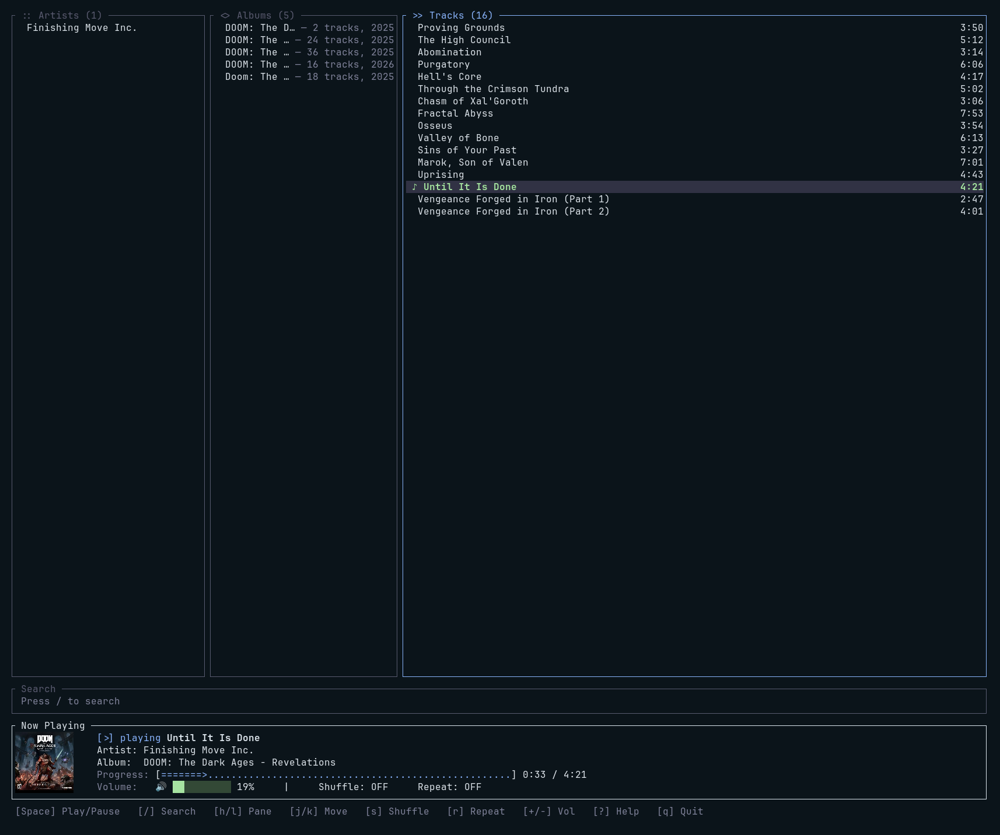
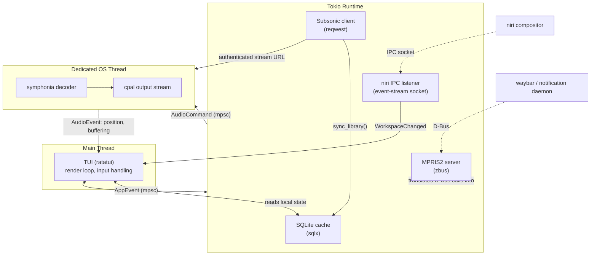

# riptune

*Rip and tune.* A terminal-native music client for [Subsonic-compatible](http://www.subsonic.org/pages/api.jsp) servers (Navidrome, Airsonic, Gonic), built for the [niri](https://github.com/YaLTeR/niri) scrollable-tiling compositor. Because if id Software's engine can run on a smart fridge, your music player can run on a compositor IPC socket.

## Why

Most terminal music clients treat the desktop as a black box: no MPRIS, no awareness of tiling layout, no way to hook into compositor-level keybinds. `riptune` is built the other way around, it assumes it's running inside a modern Wayland tiling setup and integrates accordingly.

## Features

- **MPRIS2 D-Bus interface** — waybar, GNOME/KDE media widgets, and hardware media keys control riptune out of the box, no riptune-specific config needed on their end.
- **Decoupled async pipeline** — network I/O (tokio) and audio decode/playback (dedicated OS thread) never share a runtime, so a slow server response can't stutter playback or freeze the UI.
- **Progressive streaming** — playback starts as soon as the first bytes arrive instead of after the whole file has downloaded; skipping cancels the old download.
- **Event-driven rendering** — the UI redraws only when something changes and builds only the rows on screen, so idle CPU is near zero and 50k-track lists scroll as fast as 20-track ones.
- **niri IPC integration** — listens on niri's event-stream socket (not polling) to react to workspace changes; exposes a local control socket so niri keybinds can trigger in-app actions like favoriting a track.
- **Local SQLite index** — the remote library is mirrored locally so the TUI opens instantly, even on servers with slow `getArtists`/`getAlbum` responses over large libraries; a fresh library sync fetches artists/albums/tracks concurrently rather than one request at a time.
- **Inline cover art** — renders actual album art in the Now Playing panel via the Kitty/iTerm2/Sixel graphics protocol where the terminal supports it, falling back to a half-block truecolor approximation otherwise.
- **Soundtrack-aware track order** — albums list by disc/track number, not alphabetically, so a game or film OST plays in the order the composer intended.
- **Live search with match highlighting** — `/` searches the focused pane in real time, highlighting the matched substring; `Esc` restores the full list with the cursor still on what you found.
- **A real queue** — next/previous, seeking, repeat all/one, and a shuffle that plays every track once before repeating.
- **Configurable theme** — an optional `[theme]` table in `config.toml` overrides individual UI colors (accent, now-playing, borders, ...) without touching code.

## Terminal UI



Miller columns (Artists → Albums → Tracks): moving the cursor previews the next column, and each pane keeps its own cursor. The layout adapts to the window — three columns when wide, two when medium, just the focused one when narrow, and the Now Playing deck collapses to a two-line strip on short terminals. The bottom line shows key hints, the search prompt, status/errors, and library sync progress.

| Key | Action |
| --- | --- |
| `j` `k` / `↓` `↑` | Move cursor |
| `h` `l` / `←` `→`, `Tab` | Previous / next pane |
| `g` `G`, `PgUp` `PgDn`, `Ctrl-u` `Ctrl-d` | Jump to top / bottom, page |
| `Enter` | Open / play from this track |
| `o` | Jump to the playing track |
| `/` | Search the focused pane (`Tab` switches scope, `Enter` keeps results, `Esc` cancels) |
| `Space` | Play / pause |
| `n` `p` | Next / previous track |
| `,` `.` | Seek −/+ 10 s |
| `-` `+` | Volume down / up |
| `s` | Toggle shuffle |
| `r` | Cycle repeat (off → all → one) |
| `?` | Help overlay |
| `q`, `Ctrl-c` | Quit |

## Architecture



**Why three execution contexts instead of one?** Audio playback is latency-sensitive in a way that async task scheduling doesn't guarantee a busy tokio runtime (e.g. mid-sync with the server) shouldn't be able to introduce a buffer underrun. Giving audio its own OS thread with a bounded channel as the only interface makes that impossible by construction, not by careful scheduling.

## Repository layout

```
riptune/
├── src/                 # binary crate: wires everything together
│   ├── main.rs
│   ├── app.rs           # async orchestration (tokio runtime)
│   ├── audio.rs         # audio thread entrypoint
│   ├── config.rs
│   └── events.rs
├── crates/
│   ├── riptune-core/     # Subsonic REST client, auth, models
│   ├── riptune-cache/    # SQLite local index
│   ├── riptune-mpris/    # MPRIS2 D-Bus server
│   ├── riptune-niri/     # niri IPC event-stream listener
│   ├── riptune-tui/      # ratatui UI
│   └── riptune-types/    # shared types crossing thread/crate boundaries
├── Cargo.toml            # workspace root
└── config.example.toml
```

## Configuration

`~/.config/riptune/config.toml`:

```toml
[server]
url = "https://music.example.com"
username = "you"
# Either a legacy Subsonic password (salted-token auth is computed at runtime,
# never sent in the clear) or a Navidrome API key, depending on server support.
password = "your-password-or-api-key"

[niri]
enabled = true
workspace_notifications = true

[cache]
path = "~/.cache/riptune/library.sqlite"

# Optional. Every key is optional too -- anything left out keeps riptune's
# built-in default for that color. Values are "#rrggbb" hex.
# [theme]
# accent = "#89b4fa"
# now_playing = "#a6e3a1"
# error = "#f38ba8"
# border_focused = "#89b4fa"
# border_unfocused = "#585b70"
# selection_bg = "#313244"
```

## Building

```sh
cargo build --release
```

Requires a D-Bus session bus (for MPRIS) and, optionally, a running niri instance (for IPC features — riptune degrades gracefully without them).

